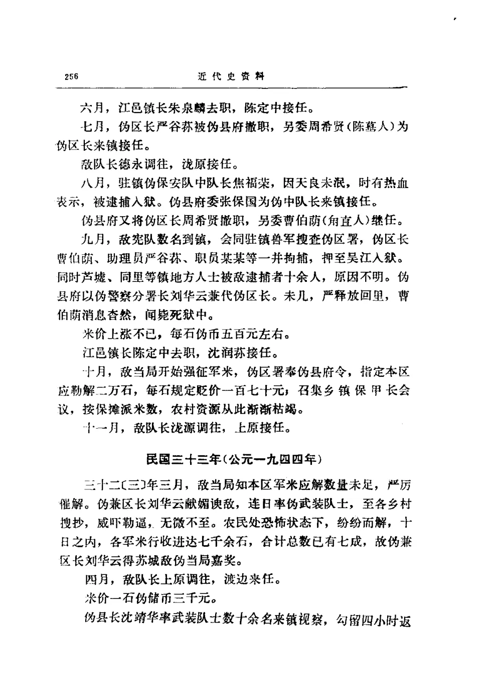
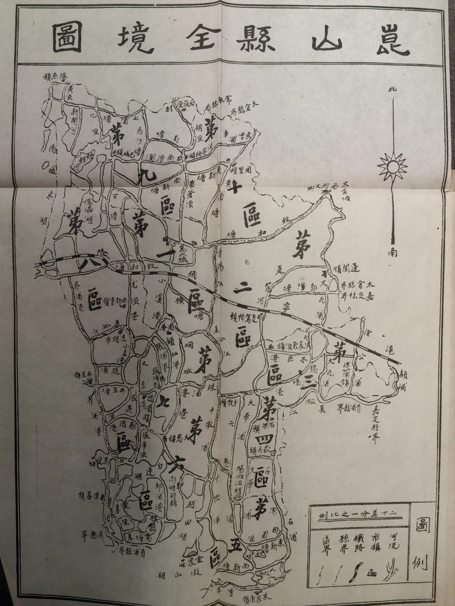
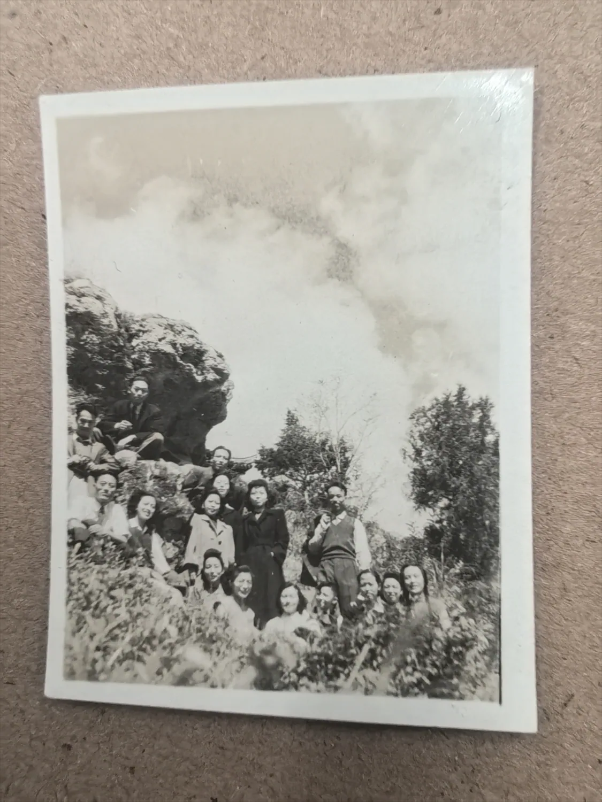
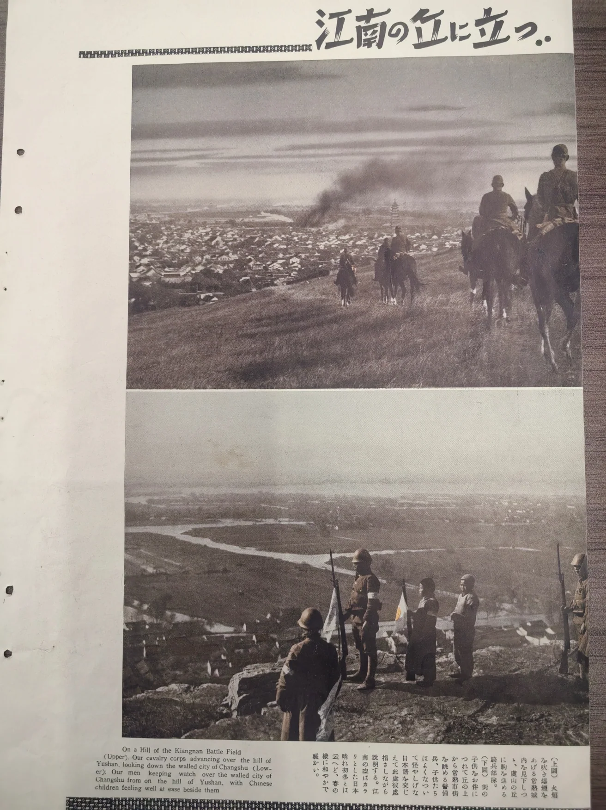

# The Days That Remain

**ARHU 101 — Archival Project Worksheet**  
**Name:** Sitong Chang  
**Project:** https://thedaysthatremain.vercel.app/

## 1. Which archive did you select, and how does it align with the definition of an archive?

For my project, I chose Zhu Runcang’s 贞丰八年血泪录, which describes life in Zhouzhuang from 1937 to 1945. I used the version printed in Jindaishi Ziliao, no. 54 (1984), pages 234–263. I also looked at old newspapers, local history articles, and photographs from DKU Special Collections. The DKU materials include travel guides, maps, pictures of Tinglin Hill, postcards, and Japanese wartime publications. I liked seeing how different these records were. A diary describes what people experienced, while a guidebook shows what visitors might have seen or been told about the area. Putting them together helped me get a fuller picture of the place.

## 2. How did you use your archival materials in your writing?

I turned the materials into a bilingual website called The Days That Remain. The main part is a reader with 328 passages from Zhu’s account. I added a search function, notes, and scans of the printed pages so people can check the text for themselves. I also put newspaper reports and DKU photographs next to some of the passages. My favorite part to work on was the rice-price chart. Zhu mentions prices at different points in the account, and I wanted to see what they looked like together. You can click a point on the chart to find the passage it came from. I kept the captions fairly short because I wanted people to spend time looking at the materials.

## 3. What was your independent research process? Please include any sources or inspirations you used.

I started with the diary and made notes about details that kept coming up, especially refugees, boats and waterways, rice collection, and prices. Then I looked for related material in Shen Bao, Wujiang Wenshi Ziliao (vol. 15), and the DKU collections. Some things were harder to match than I expected. A newspaper might mention the same town or subject but describe a different incident. I went back to the dates and place names quite a few times. For the website, I looked at annotated books and independent magazines. I tried several layouts before settling on something that felt more like a book people could browse at their own pace.

## 4. How did you approach ethical considerations in your writing?

I paid attention to where each image and quotation came from. The text I used was published in 1984, so I list that edition and its page numbers. I also checked dates carefully because Zhu used the lunar calendar and the newspapers used the Gregorian calendar. Some of the DKU photographs show Kunshan or Suzhou more generally, so I use them to give a sense of the area. I was especially interested in the Japanese postcards and wartime publications. Their captions show how the publishers wanted these places and events to be seen, which is worth keeping in mind when reading them. I included source credits and left out dates or catalog details I couldn't confirm. The original diary passages stay in Chinese, with English explanations alongside them.

## 5. Please attach relevant images of the archives that you used.

I included four images below: a page from the 1984 edition of Zhu’s account, a historical local map, an old photograph of Tinglin Hill, and a page from a Japanese wartime illustrated publication. More photographs and scans are available on the website.

*Zhu Runcang, printed edition, Jindaishi Ziliao 54 (1984), p. 256.*

*Historical local map from the project’s archival collection materials.*

*Historical view of Tinglin Hill, DKU collection photograph.*

*Page from a Japanese-issued wartime illustrated publication, DKU collection photograph.*
